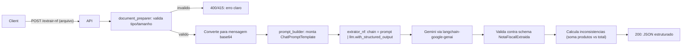

# Plano: API de Extração de Nota Fiscal com LangChain + LLM

## Decisões de arquitetura (confirmadas com o usuário)

- **Sem OCR separado**: o arquivo (PDF ou imagem) é enviado direto ao Gemini em base64, como mensagem multimodal do LangChain — igual ao que `avaliacao_automatica/services/avaliador.py` já faz com os PDFs da proposta/edital. Não haverá `pytesseract`/`pypdf` para extração de texto; a "leitura" do documento é feita pelo próprio LLM.
- **Fluxo síncrono, sem banco de dados**: `POST /extrair-nf` recebe o arquivo e devolve o JSON estruturado na própria resposta HTTP (sem status intermediário, sem MongoDB, sem BackgroundTasks). Isso simplifica o aprendizado do fluxo LangChain sem a complexidade de persistência/polling do projeto de referência.
- **Provedor de LLM**: Google Gemini via `langchain-google-genai`, reaproveitando o padrão de `services/llm_provider.py` do `avaliacao-automatica`.
- **Projeto novo**: `/var/www/extracao-nf-llm` (já contém `docs/tecnica-de-prompting.md` e `README.md`), sem tocar em `avaliacao-automatica`.

## Stack (mesma base do projeto de referência)

- FastAPI + Uvicorn
- LangChain + `langchain-google-genai`
- Pydantic / pydantic-settings
- structlog (logging estruturado)
- uv (gestão de dependências), ruff + mypy (qualidade), pytest (testes)

## Estrutura de pastas proposta

```
extracao-nf-llm/
├── src/extracao_nf/
│   ├── main.py                     # FastAPI app + lifespan
│   ├── core/
│   │   ├── config.py               # Settings (pydantic-settings)
│   │   ├── logging.py              # structlog setup
│   │   └── exceptions.py           # Exceptions customizadas
│   ├── domain/
│   │   ├── enums.py                # TipoDocumento, TipoInconsistencia
│   │   └── models.py                # Contrato JSON da NF (Pydantic)
│   ├── services/
│   │   ├── document_preparer.py    # Validação + conversão do arquivo p/ multimodal
│   │   ├── llm_provider.py         # Factory do ChatGoogleGenerativeAI
│   │   ├── prompt_builder.py       # ChatPromptTemplate (one-shot/few-shot)
│   │   └── extrator_nf.py          # Orquestração: prepara -> chama LLM -> valida
│   └── api/
│       ├── routes/
│       │   ├── health.py
│       │   └── extrair.py          # POST /extrair-nf
│       └── deps.py
├── tests/
│   ├── unit/
│   └── integration/
├── docs/
│   └── tecnica-de-prompting.md     # já existe
├── pyproject.toml
├── Makefile
├── .env.example
└── README.md
```

## Fluxo completo (visão geral)



## Partes de desenvolvimento (cada uma é um incremento executável e testável)

### Parte 1 — Esqueleto do projeto
**Objetivo:** ter um app FastAPI rodando, sem lógica de negócio ainda.
**Entrega:** `pyproject.toml`, `Makefile` (install/lint/format/test/run), `src/extracao_nf/main.py`, `core/config.py`, `core/logging.py`, endpoint `GET /health`.
**Conceitos aprendidos:** estrutura de projeto Python moderno (uv, ruff, mypy), `pydantic-settings`, lifespan do FastAPI.
**Critério de pronto:** `make install && make run` sobe o servidor; `GET /health` responde 200.

### Parte 2 — Contrato de dados (domínio)
**Objetivo:** modelar o JSON de saída da API antes de qualquer integração com LLM.
**Entrega:** `domain/models.py` com `Emitente`, `Destinatario`, `DadosNota`, `Valores`, `Produto`, `Inconsistencia`, `NotaFiscalExtraida` (schema completo pedido no requisito), `ExtracaoResponse`. Campos ausentes/incertos como `str | None`.
**Conceitos aprendidos:** modelagem Pydantic, `Field(description=...)` (documenta o schema para o LLM depois), como representar "campo não encontrado" vs "inconsistência".
**Critério de pronto:** testes unitários simples validando serialização/validação dos modelos (sem LLM envolvido).

### Parte 3 — Endpoint de upload (sem LLM ainda)
**Objetivo:** receber o arquivo via API e validar antes de gastar chamada de LLM.
**Entrega:** `api/routes/extrair.py` com `POST /extrair-nf` (`UploadFile`), validação de `content-type` (`application/pdf`, `image/png`, `image/jpeg`) e tamanho máximo; retorna erro 415/400 claro para arquivo inválido; caso válido, por ora retorna um stub (nome do arquivo, tamanho, tipo).
**Conceitos aprendidos:** upload de arquivos no FastAPI, validação de entrada, respostas de erro padronizadas.
**Critério de pronto:** testes de integração cobrindo arquivo válido (PDF/PNG/JPG) e inválido (tipo errado, vazio, corrompido).

### Parte 4 — Preparação do documento para o LLM
**Objetivo:** transformar o arquivo validado em conteúdo multimodal para o LangChain.
**Entrega:** `services/document_preparer.py`: lê bytes, detecta mime type, valida se é um PDF/imagem legível de fato (ex.: assinatura de arquivo/magic bytes, tentativa de abrir com `Pillow` para imagem), codifica em base64 e monta o payload `data:<mime>;base64,<...>` usado pela mensagem do LangChain. Erros de leitura viram exceptions específicas (`ArquivoInvalidoError`, `ArquivoIlegivelError`).
**Conceitos aprendidos:** manipulação de bytes/base64, diferenciação entre "documento digital" e "escaneado" (aqui tratada de forma transparente, pois o LLM lê ambos), tratamento de erros permanentes vs. arquivo corrompido.
**Critério de pronto:** testes unitários simulando PDF válido, imagem válida, arquivo corrompido/vazio.

### Parte 5 — Prompt e chain LangChain (sem orquestração de erros ainda)
**Objetivo:** aplicar a documentação de `docs/tecnica-de-prompting.md` na prática — construir o prompt que orienta o LLM a extrair os campos.
**Entrega:** `services/prompt_builder.py` com `ChatPromptTemplate` (few-shot: 1-2 exemplos de NF-e cobrindo campo ausente e lista de produtos, como nos exemplos da doc); `services/llm_provider.py` com `criar_chat_model(settings)` (Gemini); função `montar_chain()` que faz `prompt | llm.with_structured_output(NotaFiscalExtraida)`.
**Conceitos aprendidos:** `ChatPromptTemplate.from_messages`, mensagens multimodais (`image_url`/PDF em base64), `with_structured_output`, relação direta com a Parte 2 (o schema Pydantic *é* o contrato que o LLM deve preencher).
**Critério de pronto:** chamada manual (script/teste com chave real ou mock) retorna um `NotaFiscalExtraida` válido a partir de uma NF de exemplo.

### Parte 6 — Orquestração do serviço (`extrator_nf.py`)
**Objetivo:** juntar Partes 4 e 5 em um serviço só, cobrindo os critérios de aceite de robustez.
**Entrega:** `services/extrator_nf.py::extrair_nota_fiscal(arquivo) -> ExtracaoResponse`:
- chama `document_preparer` e `prompt_builder`/chain;
- captura falhas do LLM (timeout, rate limit, erro 5xx) reaproveitando o padrão de `core/exceptions.py` (`TransientError`/`PermanentError`) do projeto de referência;
- calcula inconsistências determinísticas (ex.: soma dos `valor_total` dos produtos vs. `valores.valor_total_nota`) e preenche `Inconsistencia[]` sem interromper o processamento;
- campos que o LLM não conseguiu extrair permanecem `null`, nunca quebram a resposta.
**Conceitos aprendidos:** orquestração de serviço (mesmo papel de `avaliador.py`), separação entre erro que impede a resposta (arquivo ilegível) e erro que só sinaliza inconsistência (campo ausente/valores não batem).
**Critério de pronto:** testes unitários com LLM mockado cobrindo: extração completa OK, campo faltante, soma divergente, erro do LLM.

### Parte 7 — Ligar tudo no endpoint + tratamento de erros da API
**Objetivo:** endpoint final, com respostas HTTP corretas para cada cenário do critério de aceite.
**Entrega:** atualizar `api/routes/extrair.py` para chamar `extrator_nf.extrair_nota_fiscal`; mapear exceptions para status HTTP (400/415 arquivo inválido, 422 ilegível, 502/504 falha do LLM) com mensagens claras; logging estruturado (structlog) em cada etapa, mirando `core/logging.py` do projeto de referência.
**Conceitos aprendidos:** tratamento de exceptions em camadas (domínio -> serviço -> API), boas práticas de mensagens de erro para consumidores da API.
**Critério de pronto:** teste de integração ponta a ponta (com LLM mockado) validando contrato de resposta e códigos de erro.

### Parte 8 — Testes finais e qualidade
**Objetivo:** consolidar suíte de testes e qualidade de código no padrão do projeto de referência.
**Entrega:** `tests/unit` e `tests/integration` organizados (mirror de `avaliacao-automatica/tests`), `tests/fakes.py` com um LLM fake, `conftest.py`; `make lint`/`make test` passando.
**Conceitos aprendidos:** estratégia de testes para pipelines de LLM (mock da chain), fixtures reutilizáveis.
**Critério de pronto:** `make lint && make test` verde.

### Parte 9 (extra/opcional) — Observabilidade e Docker
**Objetivo:** fechar o paralelo com o projeto de referência para a apresentação ao time.
**Entrega:** tracing LangSmith (mesmo padrão de `main.py`/`config.py` do `avaliacao-automatica`), `Dockerfile` + `HEALTHCHECK`, CI básico (ruff/mypy/pytest).
**Critério de pronto:** `docker build` funcional; workflow de CI rodando.

## Ordem de execução

As partes serão implementadas uma a uma, cada uma em sua própria resposta/commit, para que você acompanhe e entenda o que foi criado antes de avançar para a próxima.
